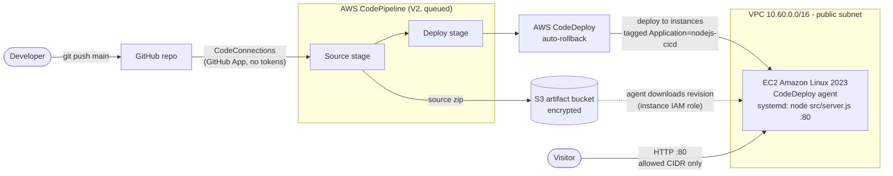

# End-to-End CI/CD Deployment of a Node.js App

An **Express.js** app that deploys itself: every `git push` to `main` triggers
**AWS CodePipeline**, which hands the code to **AWS CodeDeploy**, which installs it on an
**Amazon EC2** instance, restarts the service, health-checks it, and **rolls back
automatically** if the check fails.

The pipeline, deployment group, IAM roles, VPC and EC2 server are all one CloudFormation template.

## Architecture



## How a deployment runs (`appspec.yml`)

| Hook | Script | What it does |
|------|--------|--------------|
| ApplicationStop | `scripts/stop_server.sh` | Stops the running service. Always exits 0, because CodeDeploy runs this from the *previous* revision |
| BeforeInstall | `scripts/before_install.sh` | Installs Node.js 22 LTS from nodejs.org (**SHA-256 verified**) and creates the `nodeapp` service user |
| *(files copied)* | | Revision copied to `/opt/nodeapp` (`file_exists_behavior: OVERWRITE`) |
| AfterInstall | `scripts/after_install.sh` | `npm ci --omit=dev`, writes `deploy-info.json`, sets read-only ownership, installs the systemd unit |
| ApplicationStart | `scripts/start_server.sh` | `systemctl restart nodeapp` |
| ValidateService | `scripts/validate_service.sh` | Polls `/health`. If it fails, the deployment fails and **CodeDeploy rolls back** |

The home page shows the **deployment ID and time**, so you can see each push go live.

## Security measures

- **No GitHub tokens.** The source is connected with AWS CodeConnections (a GitHub App with OAuth).
  The pipeline role may use the connection **only for this repository**
  (`codeconnections:FullRepositoryId` condition).
- **Least-privilege IAM:**
  - Pipeline role: the artifact bucket and this CodeDeploy application/group only.
  - Instance role: read artifacts + SSM.
  - The pipeline role's trust policy includes an `aws:SourceAccount` condition (confused-deputy protection).
- **The app doesn't run as root.** A dedicated `nodeapp` user binds port 80 through
  `CAP_NET_BIND_SERVICE`. The systemd sandbox adds `ProtectSystem=strict`, `NoNewPrivileges`,
  `PrivateTmp` and more. App files are read-only to the service.
- **No SSH.** Admin access is through SSM Session Manager. HTTP is open only to your CIDR.
- **Verified downloads.** The Node.js tarball is checked against the official SHA-256 list.
  `npm ci` installs exact versions from `package-lock.json`.
- **Hardened app:** `X-Powered-By` removed, `nosniff` / `DENY` framing / `no-referrer` headers set.
- **Encryption:** artifact bucket (SSE-S3, TLS-only policy) and encrypted EBS. IMDSv2 required.

## Repository layout

```
src/app.js, src/server.js        Express app (/, /health, /api/info)
public/index.html                Home page showing the live deployment
test/app.test.js                 Tests (node:test, no extra dependencies)
appspec.yml                      CodeDeploy lifecycle hooks
scripts/*.sh                     Hook scripts run on the EC2 instance
config/nodeapp.service           Hardened systemd unit
infrastructure/template.yaml     VPC, EC2, CodeDeploy, CodePipeline, CodeConnections, IAM
```

## Run locally

```bash
npm install
npm test
npm start            # http://localhost:3000
```

## Deploy

1. **Create the stack** (use your own fork's `owner/repo` if it's different):
   ```bash
   MY_IP=$(curl -s https://checkip.amazonaws.com)

   aws cloudformation deploy \
     --stack-name nodejs-cicd \
     --template-file infrastructure/template.yaml \
     --capabilities CAPABILITY_IAM \
     --parameter-overrides AllowedCidr=${MY_IP}/32 GitHubRepository=siva-tharan/aws-nodejs-cicd-pipeline
   ```
2. **Approve the GitHub connection** (one-time, console only):
   **Developer Tools -> Settings -> Connections** -> select `nodejs-cicd-github` ->
   **Update pending connection** -> authorize the AWS Connector for GitHub app for this repository.
3. **Run the pipeline** (it will have failed while the connection was pending):
   ```bash
   aws codepipeline start-pipeline-execution --name <PipelineName>
   ```
4. Open the `AppUrl` output.

## See CI/CD in action

1. Change `"version": "1.0.0"` to `"1.1.0"` in `package.json`, then commit and push.
2. Watch **CodePipeline** (Source -> Deploy) and the **CodeDeploy** lifecycle events in the console.
3. Refresh the app. The version, deployment ID and time have changed.
4. **Test the rollback:** make `/health` return status 500, then push. ValidateService fails,
   CodeDeploy marks the deployment failed and redeploys the last good revision.

## Clean up

```bash
aws cloudformation delete-stack --stack-name nodejs-cicd
```

The artifact bucket is kept. Empty it in the S3 console and delete it.

## What I'd change for production

- Add a **CodeBuild** stage that runs `npm test` before deploying (true CI gate)
- Put an **Auto Scaling group behind an ALB** and use blue/green or one-at-a-time deployments
- Add a manual approval stage before production, plus CloudWatch alarms that trigger rollback
- Serve HTTPS through the ALB with an ACM certificate

## Skills demonstrated

`AWS CodePipeline` `AWS CodeDeploy` `AWS CodeConnections` `Amazon EC2` `IAM` `Amazon S3`
`Amazon VPC` `Systems Manager` `CloudFormation` `Node.js` `Express.js` `systemd` `Bash` `GitHub`
